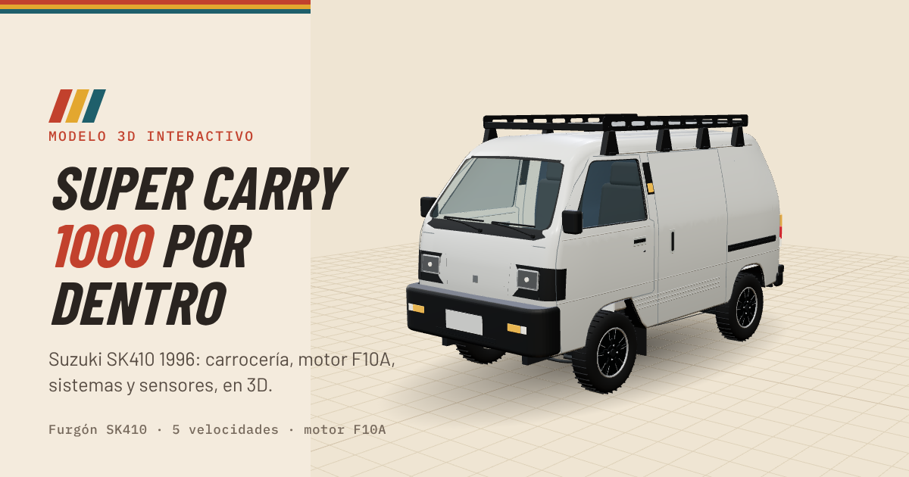

# Modelo 3D interactivo Super Carry 1000cc

**[Ver el modelo en 3D →](https://roberto-larregla.github.io/super-carry-3D/)**

Modelo 3D interactivo de mi **Suzuki Super Carry 1000 (SK410) 1996**: furgón ciego, volante a la izquierda, caja de 5 velocidades y carburador no catalítico.

Incluye la carrocería medida en fotos del furgón, el motor F10A completo en su lugar (con corte, rayos X y animación), todos los sistemas, el mapa de sensores, diagramas animados, ficha técnica, plan de mantención, diagnóstico y un mapa de qué tan preciso es cada dato mostrado.

## Cómo está hecho

| Archivo | Qué tiene |
|---|---|
| `src/data.js` | Piezas, descripciones, datos técnicos, fuentes, mantención, diagnóstico y precisión de cada dato |
| `src/body3d.js` | Carrocería medida en las fotos, luces, parachoques, parrilla y ruedas |
| `src/van3d.js` | Chasis, suspensión, frenos, calefacción, combustible, escape, eléctrico e interior |
| `src/engine3d.js` | Motor F10A completo |
| `src/viewer3d.js` | Visor 3D (three.js): vistas, cortes, despiece, colores y selección |
| `src/main.js` | Interfaz: panel con Sistemas, Piezas, Sensores y Datos, hoja deslizable en el celular y controles del visor |
| `src/diagrams/` | Diagramas animados, mapa de sensores y mapa de precisión |
| `src/styles/` | Estilos: `app.css` (interfaz, paleta crema, rojo teja, mostaza y petróleo) y `diagramas.css` |
| `index.template.html` | Estructura de la página |
| `build.mjs` | Arma el archivo único (JavaScript, tipografías y código fuente adentro) |
| `tools/` | Pruebas y capturas con Playwright |

## Precisión

Cada pieza tiene tres notas (ubicación, forma y medidas, datos) en `QUAL` dentro de `src/data.js`, que se muestran en *Datos → Precisión* y en *Color → Precisión* del visor. La lista `NEEDS` dice qué fotos o medidas subirían la precisión.

## Licencias y fuentes

- [three.js](https://threejs.org) — licencia MIT.
- Tipografías Barlow, Barlow Condensed e IBM Plex Mono — SIL Open Font License 1.1 (textos en `fonts/`).
- Parte de los datos técnicos viene del manual de servicio del Suzuki SK410; el resto, del catálogo de repuestos OEM y de las fuentes listadas en la página.

Modelo conceptual con fines educativos: antes de intervenir frenos, dirección, combustible, o cualquier otro cambio importante confirma los datos en el manual de taller original.
